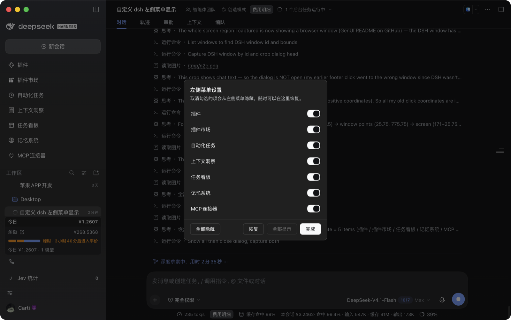
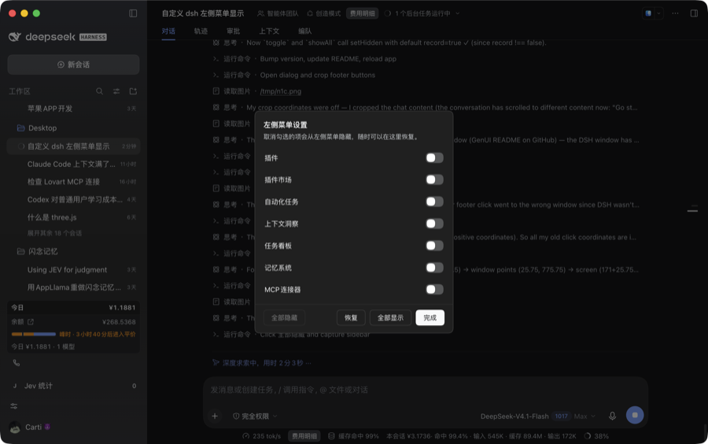

# dsh-sidebar-menu

给 DeepSeek Harness（DSH）桌面版左侧栏加一个开关面板：**勾选哪些「全局面板」项显示、哪些隐藏。**

侧栏底部多一个滑块图标；点开就是一份清单，关掉哪一项，左侧菜单立刻少一行，选择记在本机，重开还在。

<p align="center">
  
</p>

<sub>截图：7 项全部显示时的面板；右侧对话区是宿主内容，插件不参与。</sub>

---

## 功能

| 功能 | 说明 |
| --- | --- |
| 逐项勾选 | 面板每一行对应左侧菜单的一项，点一下即隐藏/恢复，菜单实时更新 |
| **全部隐藏** | 清空整列菜单（只留「新会话」与工作区），一键把侧栏收到最简 |
| **恢复** | 撤销上一步，最多连撤 20 步；「全部隐藏」点错了可以一步退回原来的选择 |
| **全部显示** | 一键恢复全部项 |
| 持久化 | 选择存在浏览器 `localStorage`，重开应用照旧 |
| 键盘与无障碍 | `Esc` 关闭；每行是 `role="switch"` + `aria-checked`；入口按钮带 `aria-label` |

禁用逻辑：没有可隐藏项时「全部隐藏」变灰，没有隐藏项时「全部显示」变灰，撤销栈空时「恢复」变灰。

<p align="center">
  
</p>

## 安装

这是一个 **DSH 本地 bundle**（`@local/…` 是官方模板沿用的本地包命名，不发布到 npm）。

### 方式一：把目录交给 DSH（推荐）

```bash
git clone https://github.com/Winjazw/dsh-sidebar-menu.git
```

然后在 DSH 会话里让它把这个目录装成 bundle，等价于调用插件管理工具：

```jsonc
{ "action": "install_bundle", "target": "/绝对路径/dsh-sidebar-menu" }
```

装完会热加载，侧栏底部出现滑块图标；没出现就 <kbd>⌘R</kbd> 重载一次。

### 方式二：手动放进 profile

```bash
# 1) 放进 profile 的 node_modules
ln -s "$PWD" ~/.dsh/profiles/<你的profile>/node_modules/@local/sidebar-menu

# 2) 在该 profile 的 package.json 里登记：
#    "dependencies": { "@local/sidebar-menu": "link:/绝对路径/dsh-sidebar-menu" }
#    "dsh": { "profile": { "bundles": [ … , "@local/sidebar-menu" ] } }
```

手动改完重启 DSH。

## 使用

1. 左侧栏最底部（「Jev 统计」与头像之间）多了个**滑块图标**，点它；
2. 弹出「左侧菜单设置」，逐项开关；
3. 需要批量处理就用底部四个按钮；
4. `完成` 或 `Esc` 关闭。此时左侧菜单已是最新状态。

> 侧栏折叠成窄图标栏时入口仍在，面板依旧居中弹出。

## 工作原理

DSH 目前**没有**「隐藏某个侧栏菜单项」的公开 API：`sidebar.panellist` 只接受 `id / order / label`，
`layout` 服务也只有 `selectPanel / toggleSidebar / openRightbar / closeRightbar`。
所以本插件走数据层过滤，一共三处：

| 环节 | 做法 |
| --- | --- |
| 菜单来源 | 包住 `ctx.slots.entriesOfSlot('sidebar.panellist')`，只对这一个 key 过滤掉被隐藏的 id，其余原样透传；`ctx.effect` 在卸载时还原原实现 |
| 触发重算 | 侧栏靠 `subscribe('sidebar.panellist')` 重算清单。插件每次改动注册一个 `order: 1e9` 的**哨兵条目**来触发刷新，哨兵本身永远被过滤，不会出现在菜单里 |
| 入口与面板 | 入口注册在 `sidebar.footer.action`，面板注册在 `shell.overlay`（该层本身 click-through，面板根节点自己开 `pointer-events:auto`） |
| 样式 | 注入一个 `<style data-plugin-css>`，颜色/圆角/焦点环全部取 `--dsw-alias-*`、`--dsw-radius-*` 等主题 token，跟随明暗主题 |

Host 侧（`index.js`）是空的：所有逻辑都在渲染进程，不改宿主任何文件。

## 兼容性

**能保证**：不兼容时被 DSH 安全拒绝，而不是装成一个半坏的插件。
**不能保证**：所有 DSH 版本都能用——它依赖上表那三处内部面，而这些会随版本演化。

| 依赖 | 缺失/变更时 |
| --- | --- |
| `engines.dsh` + DSH 的 compatibility preflight | 不满足就 `disabling profile plugin …`，插件不加载并打印原因 |
| `sidebar.footer.action` / `shell.overlay` | 缺哪个跳过哪个（`contribute()` 内 try/catch），其余照旧 |
| `entriesOfSlot` 可被包住 | 包不住 → 面板显示「当前版本不支持」，不隐藏、不报错、不影响侧栏 |

- 声明：`engines.dsh: ">=0.2.0-rc.2"`（不封上限，新版本仍会尝试加载，靠能力探测降级）
- 实测：`0.2.1-rc.2`（macOS 桌面版）
- `0.1.x`：会被拒绝加载（不是坏掉）。需要的话先做隔离环境实测，再把下限放宽

升级 DSH 后复查三步：底部图标还在吗 → 面板能列出项吗（列出 = `entriesOfSlot` 还能用）→ 关一项菜单真的少了吗。

若被拒绝加载，可在 profile 目录的 `compatibility.json` 里给这个包登记显式豁免（informed grant）——这属于用户决策，插件不代劳。

## 已知限制

- 只影响「全局面板」那一列菜单；不影响工作区里的会话列表与底部状态条。
- 「恢复」是**撤销上一步**，不是「恢复默认」；撤销历史在内存里，重开应用后清空（持久化的只有当前清单）。
- 若 DSH 换了左侧菜单的数据来源，最坏表现是「面板能打开、但隐藏不生效」——侧栏本身不会坏。

## 目录结构

```
dsh-sidebar-menu/
├─ package.json        # bundle 清单：dsh.bundle.patch / dsh.client / engines
├─ cordis.patch.yml    # 插入一行插件 entry
├─ index.js            # Host 半边（有意为空）
├─ client.js           # 全部功能：过滤 + 哨兵 + 底部按钮 + 面板 + 样式
├─ locale/{zh,en}.json # 插件页里的标题与说明
├─ icon.svg
├─ docs/               # README 截图
└─ LICENSE (MIT)
```

## 开发与自检

```bash
node --check index.js
node --check client.js
node -e "JSON.parse(require('fs').readFileSync('package.json','utf8'))"
```

改完热重载：DSH 里 <kbd>⌘R</kbd>。想直接看持久化真相：

```bash
strings ~/Library/Application\ Support/@deepseek-ai/dsh-desktop/Local\ Storage/leveldb/*.log \
  | grep -A1 'dsh-sidebar-menu.hidden.v1'
```

## English

A sidebar-menu organizer for **DeepSeek Harness** desktop: choose which global panels stay in the left rail.

- Click the sliders icon at the sidebar foot → toggle any panel off; the rail updates instantly.
- Bulk actions: **Hide all** / **Undo** (up to 20 steps) / **Show all**.
- Choices persist in `localStorage`; `Esc` closes the panel.

DSH exposes no public "hide a panel" API, so the plugin filters
`ctx.slots.entriesOfSlot('sidebar.panellist')`, pokes the sidebar with a throwaway sentinel entry to force a
recompute, and renders its UI from `sidebar.footer.action` + `shell.overlay` using theme tokens only.
The host half is a no-op.

Requires DSH `>= 0.2.0-rc.2`. On a host without those surfaces it degrades to "panel opens, nothing hidden"
instead of breaking the sidebar.

Install: clone the repo, then `install_bundle` the folder in DSH (or symlink it into your profile's
`node_modules` and list it under `dsh.profile.bundles`).

## License

[MIT](./LICENSE) © 2026 Winjazw
